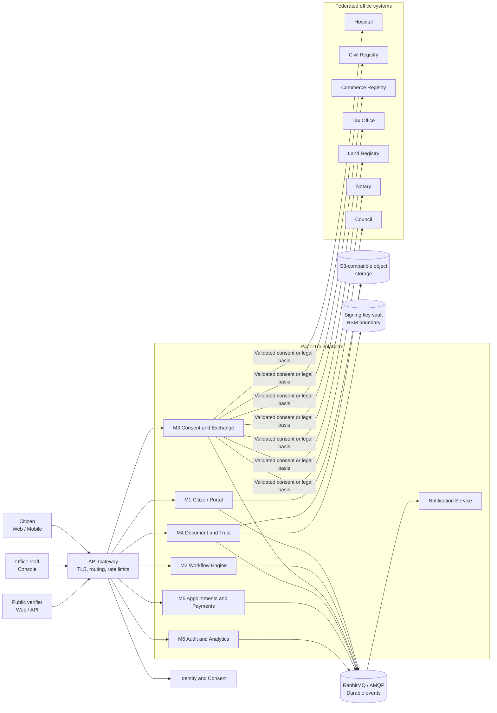
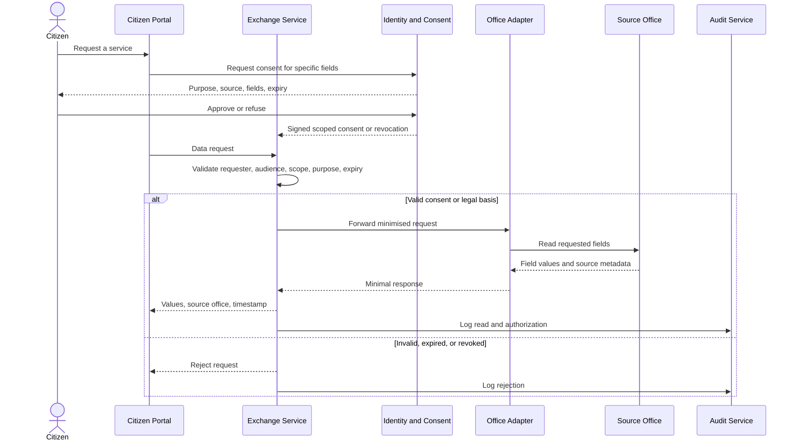
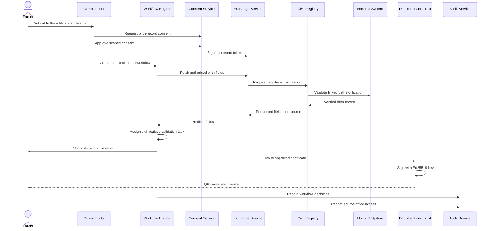
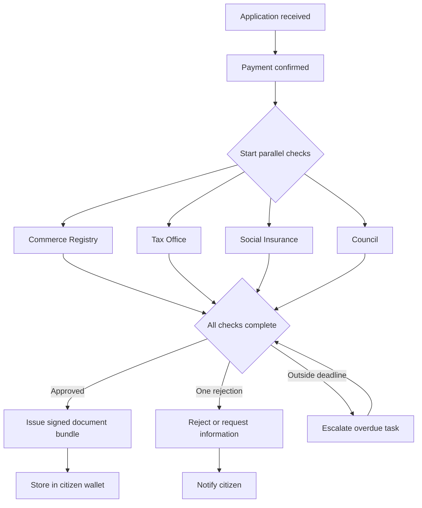
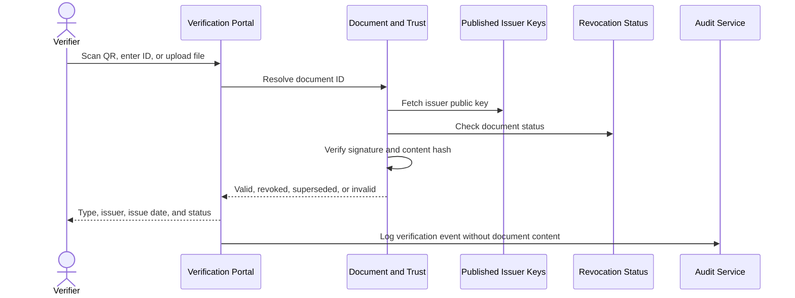
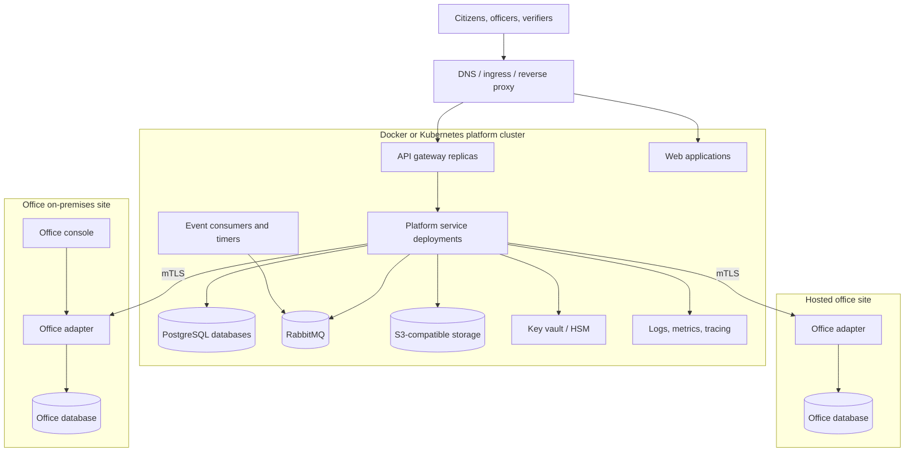

# PaperTrail

**One application. Consent-led information exchange. Signed and verifiable documents.**

[](docs/requirements/traceability.md)
[](docs/architecture/overview.md)
[](https://react.dev/)
[](https://fastify.dev/)
[](infra/kubernetes/)

PaperTrail is a federated digital public-services platform. Citizens submit one application, participating offices process assigned steps, consent controls inter-office data exchange, and approved documents are digitally signed and independently verifiable.

This repository is an implementation template derived from the PaperTrail Software Requirements Specification (SRS), not a production government system.

## Table of Contents

- [Vision](#vision)
- [SRS scope](#srs-scope)
- [Platform modules](#platform-modules)
- [Reference journeys](#reference-journeys)
- [System architecture](#system-architecture)
- [Consent and exchange design](#consent-and-exchange-design)
- [Birth certificate sequence](#birth-certificate-sequence)
- [Business registration workflow](#business-registration-workflow)
- [Document trust design](#document-trust-design)
- [Deployment architecture](#deployment-architecture)
- [Repository structure](#repository-structure)
- [Technology decisions](#technology-decisions)
- [Getting started](#getting-started)
- [Security and privacy](#security-and-privacy)
- [Implementation status](#implementation-status)
- [Documentation](#documentation)

## Vision

PaperTrail removes the citizen as a manual courier between offices. It provides:

1. A single application and status timeline.
2. A citizen-controlled consent screen for cross-office data requests.
3. A configurable workflow for approvals, parallel checks, deadlines, and escalation.
4. Independent office data ownership.
5. Signed documents with QR-based public verification.
6. Append-only audit history for access and decisions.

The platform coordinates public services. It does not replace the legal authority or become the central master database of participating offices.

## SRS scope

The SRS defines:

- Six functional modules.
- Three user-facing channels: citizen web/mobile, office console, and public verifier.
- Federated office systems connected through adapters.
- PostgreSQL 15+ databases per service.
- AMQP or Redis Streams event delivery.
- REST and JSON interfaces over TLS.
- OIDC identity, OTP, signed webhooks, S3-compatible object storage, and an external key vault/HSM.
- Docker and Kubernetes portability.
- AES-256 protection at rest, mutual TLS between offices, least-privilege access, MFA, and annual signing-key rotation.
- A 10-year default audit and consent retention period.

The source document is available at [docs/PaperTrail — Software Requirements Specification.pdf](docs/PaperTrail%20%E2%80%94%20Software%20Requirements%20Specification.pdf).

## Platform modules

| Module | Responsibility | Primary implementation |
|---|---|---|
| M1 Citizen Portal and Document Wallet | Service catalogue, applications, drafts, status timeline, uploads, wallet, delegation | `apps/citizen-web`, `services/citizen-portal`, `apps/mobile` |
| M2 Workflow Engine | State machines, tasks, parallel branches, timers, deadlines, escalation | `services/workflow` |
| M3 Consent and Inter-Office Exchange | Consent and legal-basis tokens, adapter registry, scoped requests, event publication | `services/exchange`, `services/identity-consent`, `adapters/simulated-offices/` |
| M4 Verifiable Documents and Trust | Templates, Ed25519 signing, QR codes, verification, revocation, key rotation | `services/document-trust`, `apps/verifier-web` |
| M5 Appointments, Queues and Payments | Slots, queues, fee schedules, payment, settlement, refunds | `services/appointments-payments` |
| M6 Audit and Analytics | Hash-chained audit, access history, disputes, bottleneck reports | `services/audit-analytics` |

Supporting components include the API gateway, notifications, reference adapter, object storage, event broker, identity provider, payment gateway, SMS gateway, and signing key vault.

## Reference journeys

| Journey | Participating offices | Principal interaction |
|---|---|---|
| Birth certificate | Hospital, civil registry | Hospital record creates a civil-registry draft; consent fetches and prefills verified birth data |
| Business registration | Commerce registry, tax office, social-insurance system, council | Payment precedes parallel compliance checks and bundle issuance |
| Land-title transfer | Land registry, notary, relevant authority | Title, representation, and legal checks are coordinated through the workflow |

## System architecture



### Core design rules

- Clients reach services only through the API gateway.
- Each platform service and simulated office has an independent database.
- REST contracts handle synchronous requests; events handle asynchronous coordination.
- The exchange service validates every data request and never becomes the master owner of office records.
- Workflow state is separate from audit history and document metadata.
- Verification can rely on a document signature, issuer public key, and revocation status.
- Audit is append-only and hash-chained.

## Consent and exchange design



A consent token contains at least `citizen_id`, `requesting_office`, `source_office`, `data_items`, `purpose`, `issued_at`, `expires_at`, `revoked_at`, and its signature.

Revocation blocks new requests within 60 seconds. Refused consent may fall back to a supporting upload for officer review. Legal-basis requests require a legal reference and case number and remain visible in the citizen access log.

## Birth certificate sequence



The workflow is created after submission. A fetched birth record is prefilled data, not an officer-approved decision.

## Business registration workflow



Payment covers all application fees once. M5 calculates the fee schedule in force at submission and splits settlement lines across participating offices. The workflow cannot pass its payment step until the gateway confirms payment.

## Document trust design



Every document includes a UUID, document type, issuer, UTC issue date, content hash, Ed25519 signature, QR verification address, and revocation or supersession status. Public verification reveals only the minimum status information unless the holder shares a full-view link.

## Deployment architecture



The repository includes Dockerfiles, Docker Compose dependencies, Kubernetes namespace/deployment/ingress/secret/HPA templates, and health/liveness/readiness patterns. Production deployments must replace placeholder secrets and images and provision persistent databases and storage.

## Repository structure

```text
PaperTrail/
├── apps/
│   ├── citizen-web/
│   ├── office-console/
│   ├── verifier-web/
│   └── mobile/
├── services/
│   ├── api-gateway/
│   ├── identity-consent/
│   ├── citizen-portal/
│   ├── workflow/
│   ├── exchange/
│   ├── document-trust/
│   ├── appointments-payments/
│   ├── notification/
│   └── audit-analytics/
├── adapters/
│   ├── reference-adapter/
│   └── simulated-offices/
├── packages/
│   ├── shared/
│   ├── openapi/
│   └── database-migrations/
├── infra/
│   ├── docker/
│   └── kubernetes/
├── docs/
│   ├── architecture/
│   ├── api/
│   ├── decisions/
│   ├── setup/
│   ├── runbooks/
│   └── requirements/
└── tests/
    ├── e2e/
    ├── load/
    └── security/
```

## Technology decisions

| Concern | Selected technology | Reason |
|---|---|---|
| Web frontend | React with Vite | Reusable components, strong ecosystem, mature browser tooling |
| Backend | Node.js with Fastify | Lightweight containers, JSON Schema/OpenAPI support, low startup overhead |
| Database | PostgreSQL 16+ | Transactions, constraints, mature backup and replication tooling |
| Event broker | RabbitMQ | Durable queues, acknowledgements, retry and dead-letter support |
| Object storage | MinIO locally | S3-compatible API for portable local development |
| Containers | Docker | Repeatable builds and isolated dependencies |
| Orchestration | Kubernetes | Replicas, probes, ingress, configuration, storage, and autoscaling |
| Identity | OIDC plus OTP | Standard external identity integration and SMS-capable access |
| Documents | Ed25519 in vault/HSM | Officers never handle private keys; verification is public |

Full rationale: [ADR-001: Technology Stack](docs/decisions/adr-001-technology-stack.md).

## Getting started

### Prerequisites

- Node.js 20 or later
- npm
- Docker Engine or Docker Desktop
- Docker Compose
- Optional: kubectl

```powershell
Copy-Item .env.example .env
npm install
docker compose -f infra/docker/compose.yaml up --build
```

### Local endpoints

| Component | Address |
|---|---|
| Citizen web app | `http://localhost:3000` |
| API gateway | `http://localhost:8080` |
| RabbitMQ management | `http://localhost:15672` |
| MinIO console | `http://localhost:9001` |
| PostgreSQL | `localhost:5432` |

Stop the stack:

```powershell
docker compose -f infra/docker/compose.yaml down
```

Preview Kubernetes manifests:

```powershell
kubectl kustomize infra/kubernetes/overlays/dev
```

## Security and privacy

- TLS 1.2 or later for all traffic.
- Mutual TLS for office-to-office and sensitive adapter connections.
- AES-256 encryption at rest.
- OIDC login and MFA for officers, auditors, and administrators.
- Least-privilege, office-scoped roles.
- Consent or legal-basis authorization before cross-office reads.
- Revocation enforcement for consent within 60 seconds.
- Signing keys held outside application services in a vault/HSM.
- Account lockout after five failed OTP attempts for 15 minutes.
- Request IDs, correlation IDs, audit metadata, and webhook idempotency.
- Malware scanning for uploaded PDF/JPG/PNG files.
- No real citizen data or legally relied-upon signatures in this template.

## Implementation status

| Area | Status |
|---|---|
| React citizen portal foundation | Implemented template |
| API gateway health and catalog | Implemented placeholder |
| Six module service boundaries | Documented |
| Simulated office boundaries | Documented |
| Docker Compose | Configured |
| Kubernetes base manifests | Configured |
| PostgreSQL schemas and migrations | Not implemented |
| Authentication and authorization | Not implemented |
| Consent enforcement | Not implemented |
| Workflow state machine | Not implemented |
| Document signing | Not implemented |
| Payments and appointments | Not implemented |
| Audit hash chain | Not implemented |
| Office adapters | Not implemented |

See [requirements traceability](docs/requirements/traceability.md).

## Documentation

- [Architecture overview](docs/architecture/overview.md)
- [Technology ADR](docs/decisions/adr-001-technology-stack.md)
- [Development setup](docs/setup/development.md)
- [Requirements traceability](docs/requirements/traceability.md)
- [Local deployment runbook](docs/runbooks/local-deployment.md)
- [SRS PDF](docs/PaperTrail%20%E2%80%94%20Software%20Requirements%20Specification.pdf)
