# PaperTrail Architecture and Design

This document contains the detailed logical, process, data, security, and deployment designs derived from the PaperTrail Software Requirements Specification (SRS).

The repository remains a template. Component, database, and deployment names describe intended boundaries and are not evidence that every feature is implemented.

## 1. Architectural Principles

| SRS principle | Architectural consequence |
|---|---|
| Federation, not a central office database | PaperTrail services store platform state; participating offices retain authoritative records |
| Event-driven exchange | Office changes and workflow transitions use durable asynchronous events |
| One workflow per application | A workflow instance is a state machine with tasks, branches, timers, and escalation |
| Consent before exchange | Every inter-office read requires a valid scoped consent or legal-basis token |
| Signed documents as trust anchors | Issued documents carry Ed25519 signatures and public verification information |
| Database per service and office | No service shares a database or directly queries another office's database |
| Container portability | Services run in Docker containers and target Docker or Kubernetes environments |

## 2. Logical Component Diagram

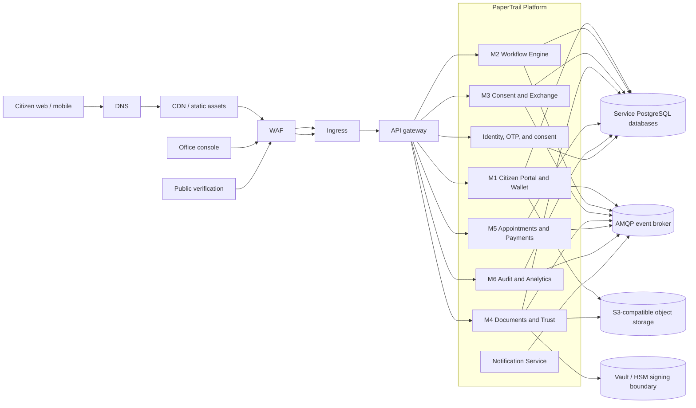

The gateway authenticates and routes external traffic. Authentication, authorization, and request-rate rules are reinforced inside each protected service where domain operations are exposed.

## 3. Module Interaction Map

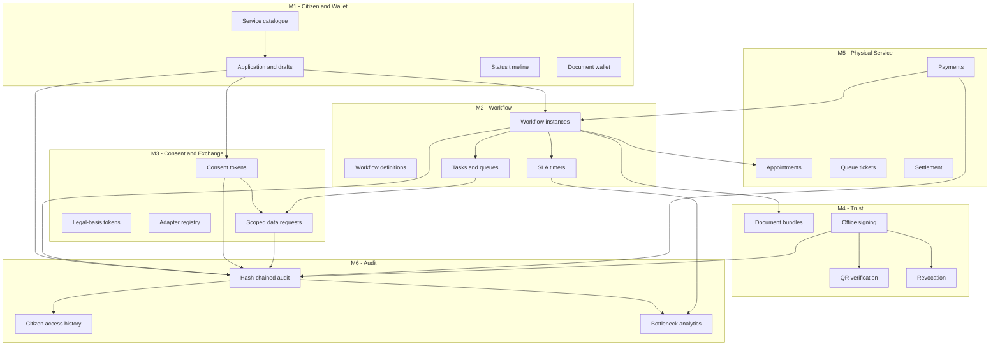

## 4. Consent and Exchange State Design

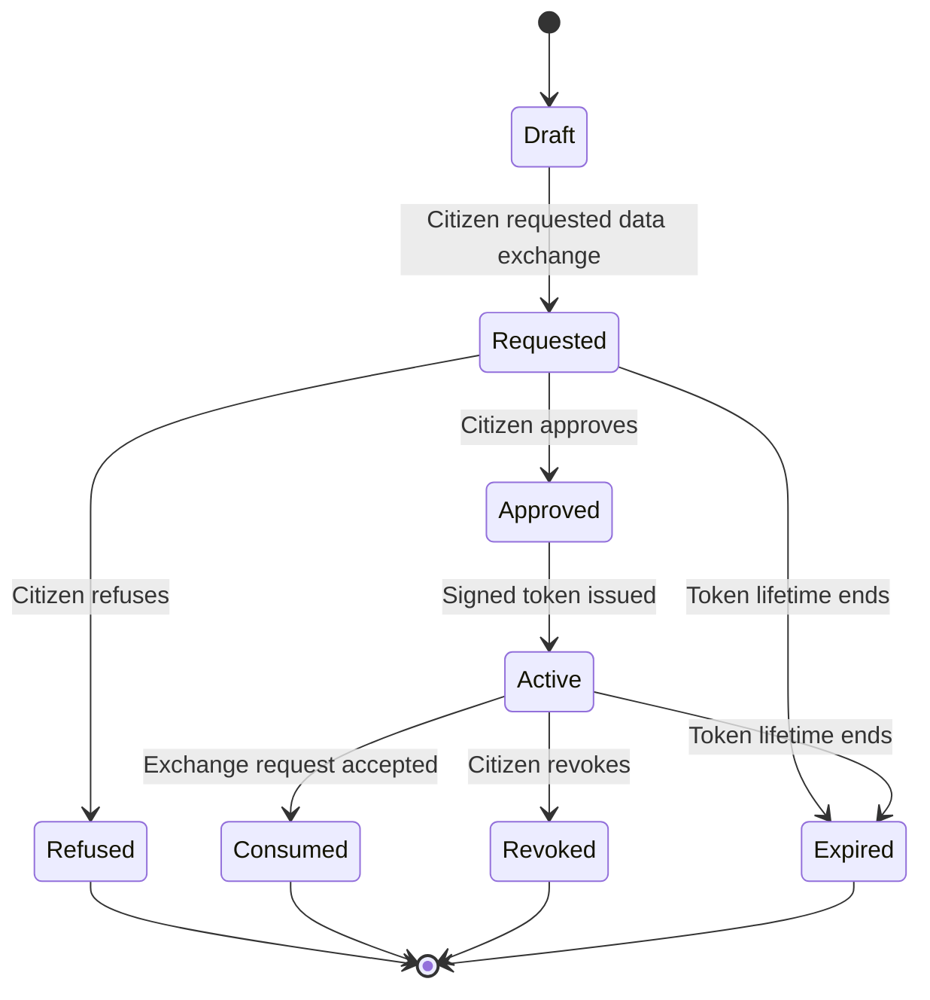

A consent token is purpose-bound and scoped to:

- Citizen identity.
- Requesting office.
- Source office.
- Requested data fields.
- Purpose.
- Issue and expiry timestamps.
- Signature and optional revocation timestamp.

The exchange service validates the signature, audience, expiry, requesting office, purpose, scope, and current revocation state on every request. Revocation must reject newly admitted requests within 60 seconds.

## 5. Consent Validation Sequence

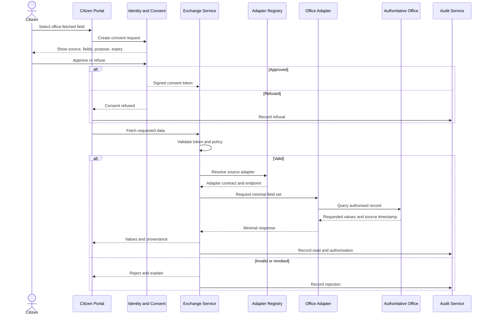

## 6. Birth Certificate Sequence

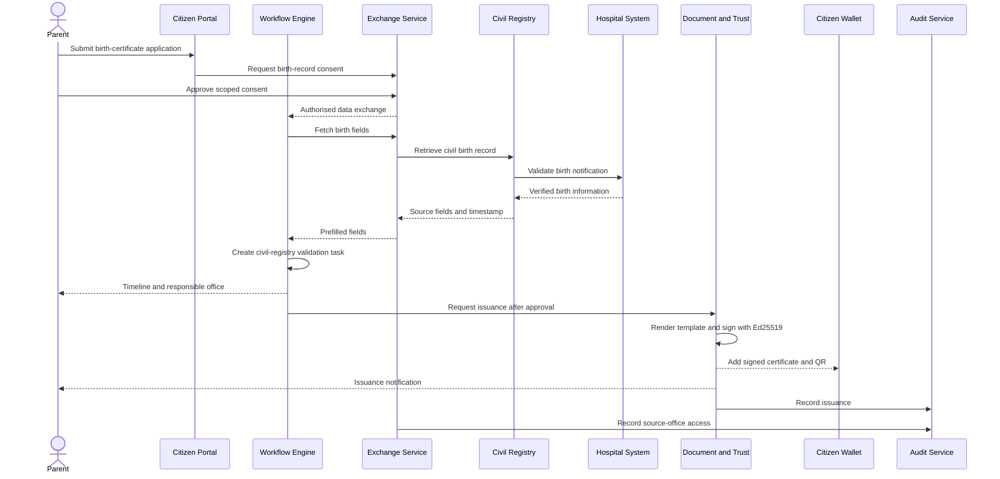

Hospital, civil-registry, citizen-wallet, and audit records remain separate. The hospital notification creates or updates a draft source record; it is not itself final citizen authorization or document issuance.

## 7. Business Registration Parallel Workflow

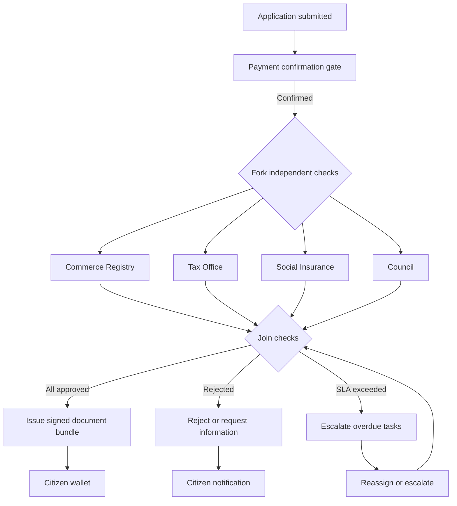

M5 calculates fees when the application is submitted and splits them by office according to the fee schedule in force. A payment gateway confirmation is a prerequisite for the workflow to pass the payment task.

## 8. Document Verification Design

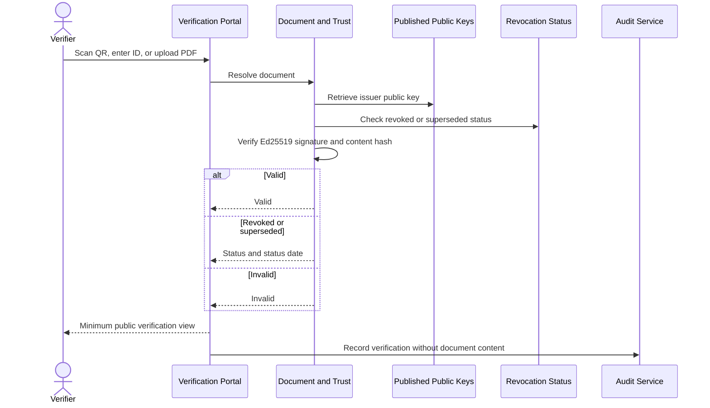

Public verification should reveal only document type, issuer, issue date, and status unless the holder provides a full-view share link. A revoked or superseded document is not deleted; it remains verifiable with its status history.

## 9. Data and Persistence Design

```mermaid
flowchart TB
    subgraph SVC["Platform services"]
        ID["Identity / Consent"]
        CP["Citizen Portal"]
        WF["Workflow"]
        EX["Exchange"]
        DOC["Document Trust"]
        PAY["Appointments / Payments"]
        AUD["Audit / Analytics"]
    end

    subgraph DB["Database-per-service"]
        DB1[("identity_consent_db")]
        DB2[("citizen_portal_db")]
        DB3[("workflow_db")]
        DB4[("exchange_db")]
        DB5[("document_trust_db")]
        DB6[("appointments_payments_db")]
        DB7[("audit_analytics_db")]
    end

    ID --> DB1
    CP --> DB2
    WF --> DB3
    EX --> DB4
    DOC --> DB5
    PAY --> DB6
    AUD --> DB7

    OBJECT[("Document and attachment object store")]
    KV[("Signing key vault")]
    MQ[("Event broker")]

    CP --> OBJECT
    DOC --> OBJECT
    DOC --> KV
    SVC --> MQ

    subgraph OFFICE["Office-owned data"]
        OH[("Hospital")]
        OC[("Civil Registry")]
        OM[("Commerce Registry")]
        OT[("Tax Office")]
        OL[("Land Registry")]
        ON[("Notary")]
        OU[("Council")]
    end

    EX -. mTLS adapter calls .-> OH
    EX -. mTLS adapter calls .-> OC
    EX -. mTLS adapter calls .-> OM
    EX -. mTLS adapter calls .-> OT
    EX -. mTLS adapter calls .-> OL
    EX -. mTLS adapter calls .-> ON
    EX -. mTLS adapter calls .-> OU
```

Cross-service foreign keys and shared database schemas are not used. Identifiers are UUIDs and timestamps are stored in UTC.

The SRS identifies these major data boundaries:

| Data area | Owning component |
|---|---|
| Identity, consent, and legal basis | Identity and Consent service |
| Application, wallet, and status | Citizen Portal |
| Workflow instances and tasks | Workflow Engine |
| Adapter contracts and exchange receipts | Exchange service |
| Document metadata and public-key metadata | Document Trust |
| Appointments, payments, settlements | Appointments and Payments |
| Audit entries and analytics | Audit and Analytics |

## 10. Event Delivery Design

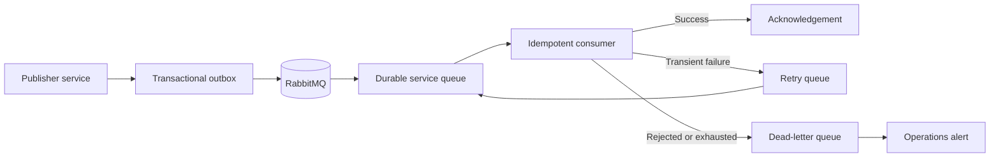

Event delivery is at least once. Consumers must deduplicate by event ID and enforce idempotency. JSON bodies use ISO 8601 timestamps in UTC.

## 11. Deployment Topology

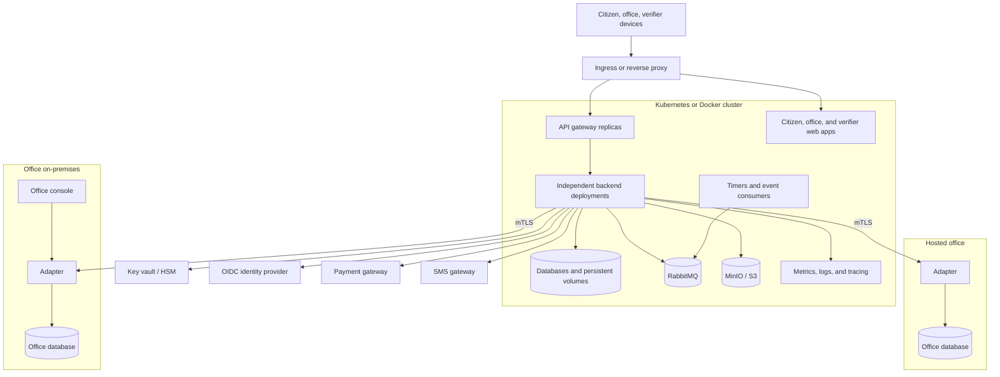

## 12. Container and Kubernetes Mapping

| Component | Local asset | Deployment direction |
|---|---|---|
| API gateway | `services/api-gateway/Dockerfile` | Deployment, Service, readiness and liveness probes |
| Citizen web | `apps/citizen-web/Dockerfile` | Deployment and Service behind ingress |
| Module services | Future service Dockerfiles | Separate Deployments, Services, HPAs, and databases |
| Office adapters | Future adapter containers | Hosted centrally or deployed on an office site |
| PostgreSQL | Docker Compose | StatefulSets or managed PostgreSQL; one database per boundary |
| RabbitMQ | Docker Compose | Managed broker or StatefulSet |
| MinIO | Docker Compose | Managed S3 or persistent local deployment |
| Key vault | External placeholder | Vault API or HSM; private signing keys never leave it |

Kubernetes assets currently provide the namespace, ingress, gateway deployment, secret example, and autoscaling template. Real secret values must be supplied through an external secret process.

## 13. Security Boundary Design

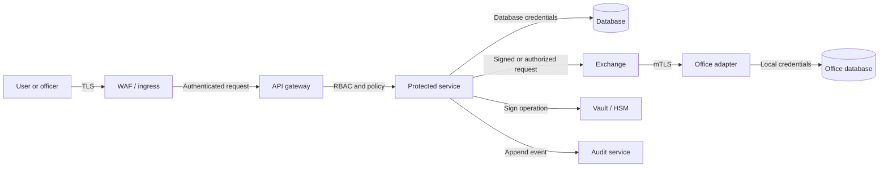

Required controls:

- HTTPS with TLS 1.2 or later.
- Mutual TLS between services and offices where sensitive exchange is required.
- OIDC for citizens and staff.
- MFA for officers, auditors, and administrators.
- Office- and role-scoped least-privilege authorization.
- AES-256 at-rest encryption.
- Signed, idempotent payment webhooks.
- HMAC-signed OTP and notification integration requests where required.
- Hash-chained append-only audit entries.
- Signing-key rotation at least annually.
- Account lockout after five failed OTP attempts for 15 minutes.

## 14. Implementation Slices

1. Establish the API gateway, identity boundary, and traceable request context.
2. Implement the application, workflow, and task models.
3. Implement consent tokens and exchange authorization.
4. Add office adapter contracts and one end-to-end simulated office.
5. Implement document templates, signing, QR verification, and revocation.
6. Implement appointments, payments, settlement, and reconciliation.
7. Implement hash-chained audit and access-history views.
8. Add retries, dead-letter handling, observability, backups, and security tests.
